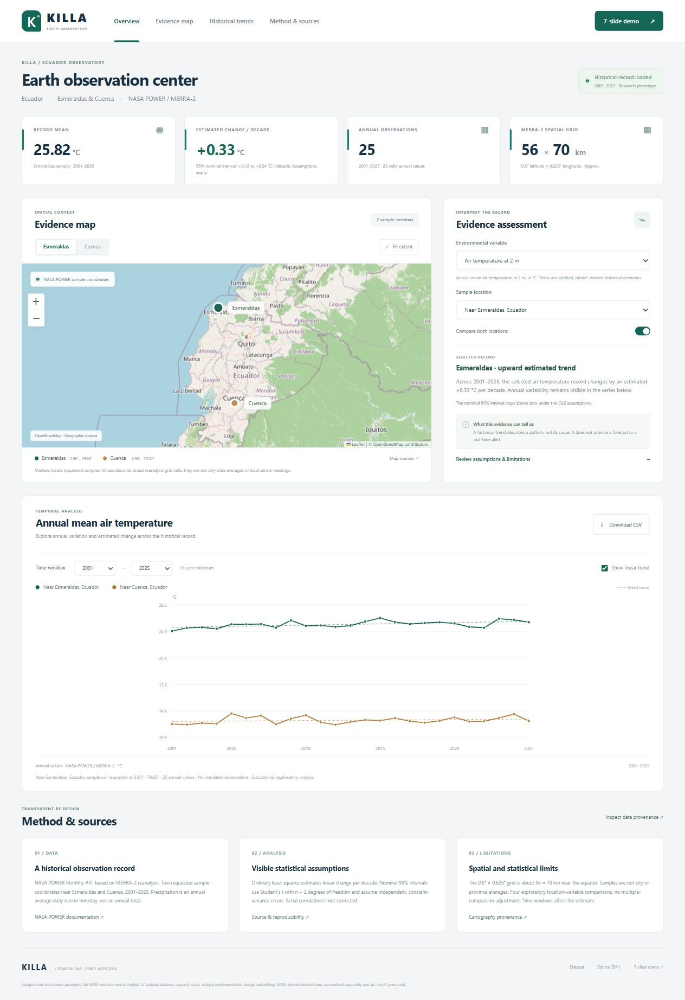

# KILLA · Earth Change Observatory

An educational Earth observation dashboard built for **NASA Space Apps 2026**, starting with Ecuador.



KILLA compares real NASA POWER annual records near **Esmeraldas** and **Cuenca**, with an interactive reference map, historical series, trend estimates, uncertainty and downloadable observations.

## Run locally

Tested with Node.js 24.21.0. No dependency installation or API key is required.

```sh
npm start
```

Open `http://127.0.0.1:4173`. The seven-slide English demonstration is at `/demo/`. Any static host can serve the `dist/` directory.

## Docker deployment

Configured domain: **https://nasaespase.ghosstless.com**. The application runs in its own `nasaespase` container, with Apache terminating HTTPS and forwarding to a loopback-only port.

```sh
docker compose -p nasaespase -f deploy/compose.yaml up --build -d
```

The container serves on port 8080, published only at `127.0.0.1:18186`. It runs as a non-root user with a read-only filesystem, a temporary `/tmp`, dropped capabilities and resource limits. Apache examples in `deploy/` configure only this domain and keep ACME validation separate. Credentials and server access details are not included in the repository.

```sh
npm test
npm run check
npm run data:build
```

## What works

- Select 2-metre air temperature or corrected precipitation.
- Compare sample cells near Esmeraldas and Cuenca on a geographic reference map.
- Select a historical window containing at least ten annual observations.
- Explore annual variation and ordinary least-squares trends.
- Inspect nominal Student-t 95% slope intervals and their assumptions.
- Download the selected observations as CSV, original data, provenance and source.
- View the seven-slide project demonstration.

## Data and interpretation

The prototype uses real **NASA POWER / MERRA-2** data for **2001–2025**. `T2M` is annual mean 2-metre air temperature in °C; `PRECTOTCORR` is annual mean daily precipitation in mm/day, **not** an annual precipitation total. The source grid is approximately 0.5° latitude × 0.625° longitude. Query points represent broad sample cells, not weather stations or city-wide averages.

Nominal slope intervals assume independent, constant-variance errors and a linear mean. Temporal dependence, model uncertainty and multiple comparisons are not corrected. Historical patterns do not establish causes or forecasts. The tool is an educational prototype, with classroom validation and global coverage as future work.

See [the complete method](analysis/README.md), [NASA provenance](data/provenance.json) and [cartographic provenance](dist/data/cartography-provenance.json).

## Sources and libraries

- [NASA POWER](https://power.larc.nasa.gov/) — original environmental records and documentation.
- [Leaflet 1.9.4](https://leafletjs.com/) — BSD-2-Clause map library; license bundled with the source.
- [OpenStreetMap contributors](https://www.openstreetmap.org/copyright) — online reference basemap with visible attribution.
- [Natural Earth](https://www.naturalearthdata.com/about/terms-of-use/) — public-domain reference geography and map fallback.
- [Rioverde dashboard](https://rioverde.ghosstless.com/) — user-provided visual reference.

Development assistance is disclosed in the application, analysis metadata and competition form. NASA source observations are unchanged; synthetic examples occur only in the explicitly named statistical tests.

## Structure

```text
dist/       Static dashboard, map assets, data and seven-slide demo
data/       Original NASA responses and reproducible data records
analysis/   Dataset builders, statistical implementation and tests
tools/      Minimal local static server
docs/       Dashboard preview
```
